<picture>
  <source media="(prefers-color-scheme: dark)" srcset="assets/pipeline-dark.svg">
  <source media="(prefers-color-scheme: light)" srcset="assets/pipeline-light.svg">
  
</picture>

**Data engineer in São Paulo.** I build pipelines that refuse bad data before it moves, like the drawing above, and I like systems I can rebuild from a single repo.

```text
$ cat now.txt
building   PureFlow, a lakehouse with a quality gate between every layer
learning   Japanese, one kanji at a time
playing    guitar through a neural amp model, and games I'll soon be recording
```

### Selected work

**[PureFlow](https://github.com/Anoterrr/PureFlow)**\
Open-source lakehouse, Delta Lake in every layer. dbt on DuckDB, orchestrated by Dagster, with Great Expectations gates that keep the next layer from building on data that failed. Tests fail the build if the gates are wired wrong. My capstone, and the project I'm proudest of.

**[zen-runbook](https://github.com/Anoterrr/zen-runbook)**\
How I set up a machine, written down. Every tool has a reason, and a read-only audit checks the machine against the repo.

**[rust-donut](https://github.com/Anoterrr/rust-donut)**\
The classic spinning `donut.c`, ported to Rust with integer math only. No floats, just bit shifts.

### Toolbox

`Python` `SQL` `dbt` `Dagster` `Airflow` `Spark` `DuckDB` `Delta Lake` `Great Expectations` `Kubernetes` `Docker` `Rust`

### Off the clock

Guitar · games, with a channel on the way · Japanese

<br>

<div align="center"><sub>Building something with data? <a href="https://linkedin.com/in/gustavo--alencar">Say hi on LinkedIn</a>.</sub></div>
